<div align="center">


# ShowTime

### Watch together. Privately.

A lightweight, **self-hosted watch-party server**. Sync movies, shows and live TV with friends in real time, with an encrypted library, friends-only privacy, smart AV1/VP9 encoding and end-to-end encrypted chat.

[](https://github.com/248Tech/ShowTime/releases)
[](https://github.com/248Tech/ShowTime/actions/workflows/ci.yml)
[](https://248tech.github.io/ShowTime/demo/)
[](LICENSE)
[](https://nodejs.org/)
[](package.json)
[](https://github.com/248Tech/ShowTime/stargazers)

**[Live demo](https://248tech.github.io/ShowTime/demo/)** &nbsp;·&nbsp; **[Website](https://248tech.github.io/ShowTime/)** &nbsp;·&nbsp; **[Install](#-install)** &nbsp;·&nbsp; **[Features](#-features)** &nbsp;·&nbsp; **[Docs](docs/)** &nbsp;·&nbsp; **[Changelog](CHANGELOG.md)**

<br>

<a href="https://248tech.github.io/ShowTime/demo/">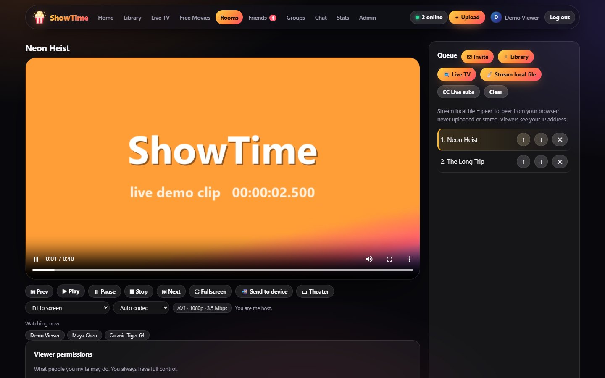</a>

<sub>The screenshots here are captured from the <a href="https://248tech.github.io/ShowTime/demo/">live demo</a>, which runs the real front-end in your browser with simulated data.</sub>

</div>

---

## ✨ Features

| | |
|---|---|
| 🍿 **Synced watch parties** | Play / pause / seek / queue / skip stay in lockstep. The host decides who may control what, and can stream a file straight from their own computer over WebRTC — nothing is uploaded. |
| 🔒 **Invisible by default** | No user directory, no search. People connect by swapping private **friend codes** off-platform. Strangers in a shared room only see anonymous aliases; online status is friends-only. |
| 🛡️ **Encrypted at rest** | Uploads, thumbnails, subtitles and avatars use chunked **AES-256-GCM** with a per-file HKDF key (seeking still works). Library folders are read-only and never modified. |
| ⚡ **Smart AV1 / VP9 / H.264** | A quick scan trial-encodes your file *on your machine* and produces only the versions worth having. Each viewer's player picks the best one for its device and can switch live. |
| 💬 **End-to-end encrypted chat** | mIRC-style. Keys are derived from a passphrase in the browser (PBKDF2 → AES-256-GCM). The server only sees ciphertext, keeps it in RAM, and **wipes everything every 48 hours**. |
| 📺 **Live TV** | Browse thousands of publicly available channels from the community [iptv-org](https://github.com/iptv-org/iptv) index, with health checks, frozen-feed detection and a hardened, SSRF-safe HLS proxy. |
| 🎭 **Auto-metadata, cast & ratings** | Upload a file and ShowTime fetches the poster, synopsis, score, cast & crew headshots and the full season / episode guide on its own (TVMaze for TV, iTunes for movie posters, TMDB with an optional free key for movie cast). Episode names replace `Episode 3` placeholders. Plus a server-wide 1–5★ rating shared by everyone on your ShowTime. Only the title leaves your server. |
| ⏺ **DVR** | Record any live channel now or on a schedule; recordings are saved into your own encrypted library, private to you. |
| 🎞 **Free movies** | Public-domain and Creative-Commons feature films from the Internet Archive, streamed through your server, nothing stored. |
| 📲 **Send to device** | Sign in on a phone, tablet or TV browser and push the current room to it. Your library follows you to every device on your account. |
| 💬 **Subtitles** | Embedded and sidecar tracks are found automatically and stored as encrypted WebVTT. Upload your own, or share subtitles live with your room, peer-to-peer. |
| 🏆 **Profiles & badges** | Watch time, recently watched, what you watch, and 30 bronze-to-platinum achievements. Private unless you choose to share with friends. |
| 🧩 **Tiny & hackable** | Plain Node.js, built-in SQLite, vanilla JS front-end. **One** runtime dependency ([nodemailer](https://nodemailer.com/)). 6 automated test suites. |

<details>
<summary><b>📸 More screenshots</b></summary>
<br>

| | |
|---|---|
| 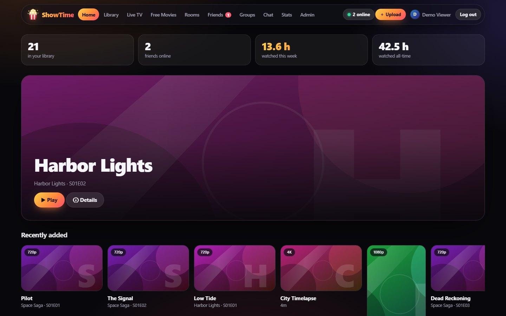<br><sub>Home</sub> | 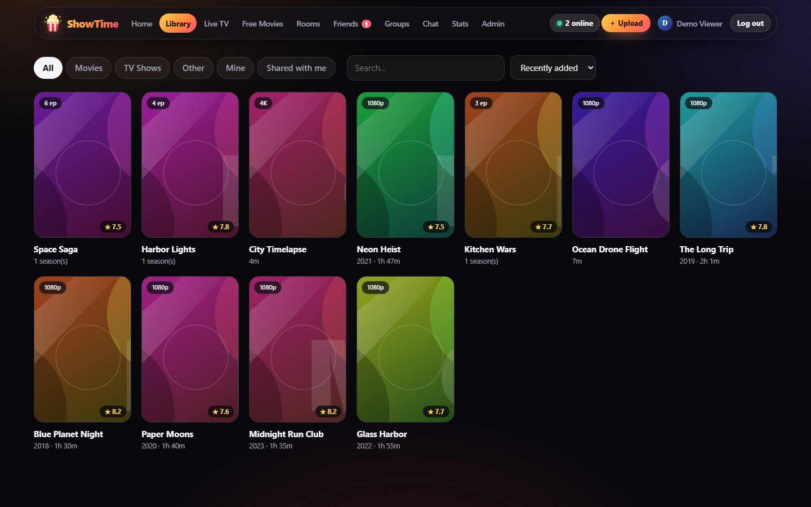<br><sub>Library with filters</sub> |
| 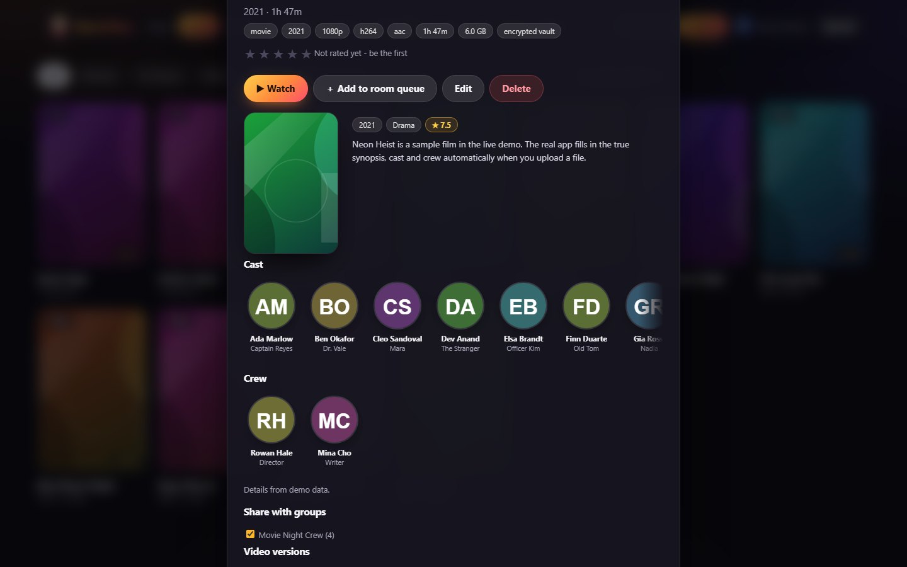<br><sub>Codec scan report</sub> | 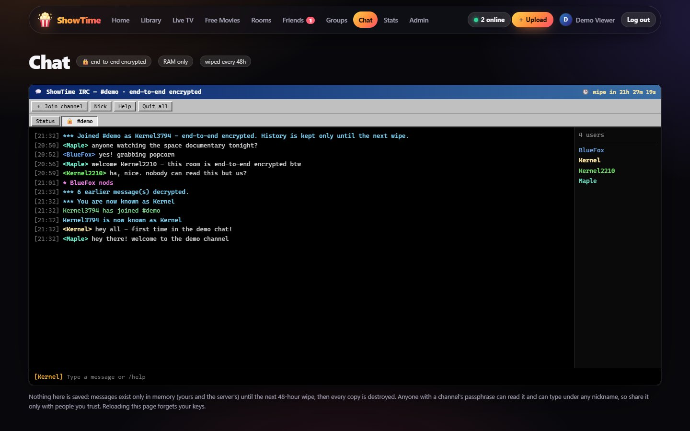<br><sub>End-to-end encrypted chat</sub> |
| 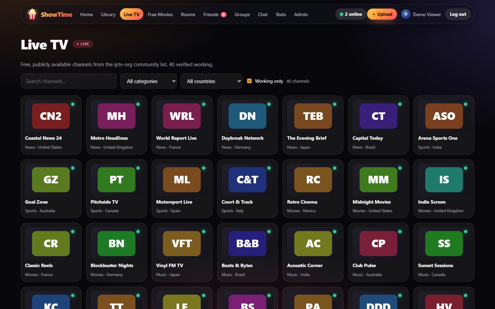<br><sub>Live TV directory</sub> | 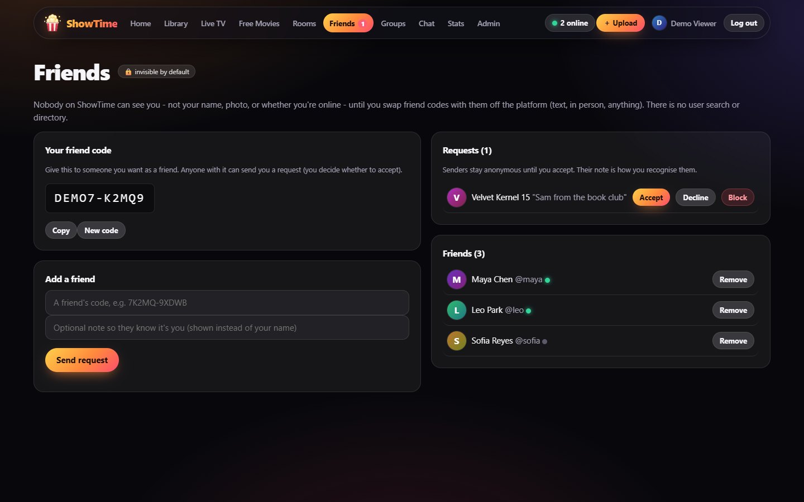<br><sub>Friend codes & anonymous requests</sub> |
| 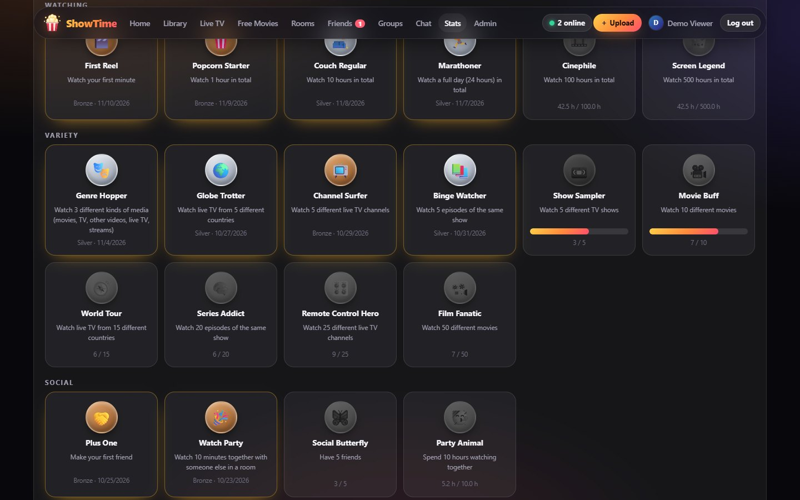<br><sub>Achievements</sub> | 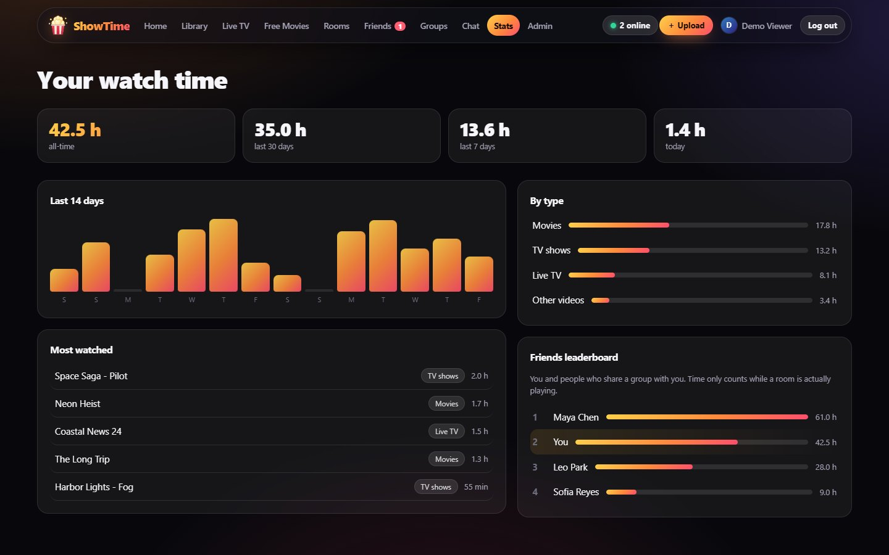<br><sub>Watch-time stats</sub> |
| 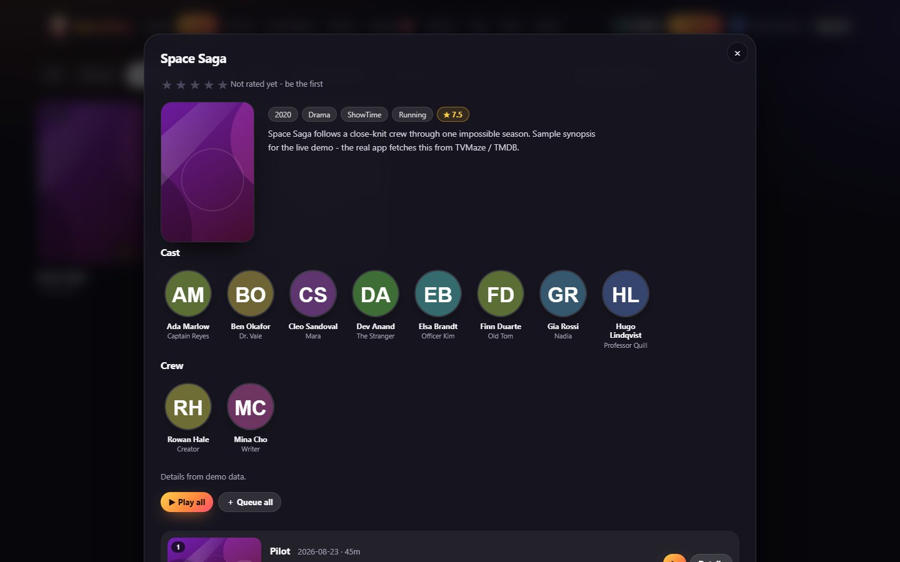<br><sub>Plex-style details: poster, cast &amp; crew, episode guide</sub> | 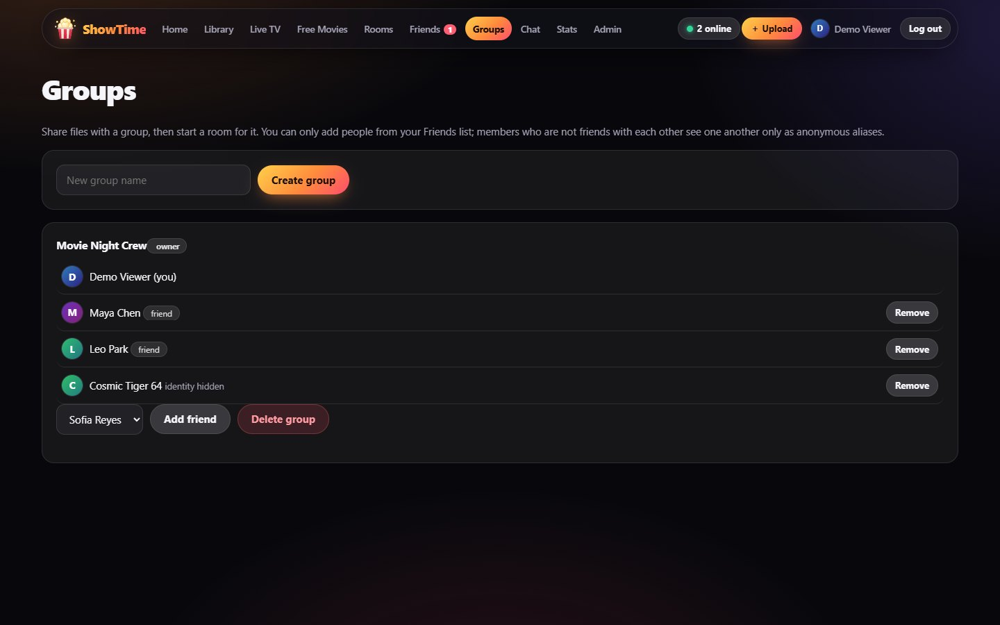<br><sub>Aliases for non-friends</sub> |
| 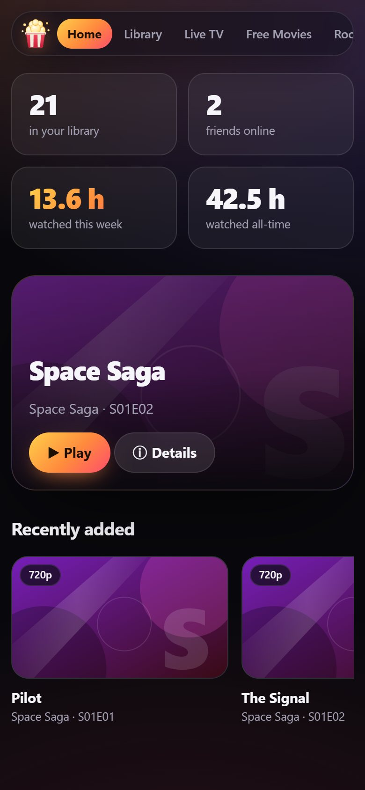<br><sub>Mobile</sub> | |

</details>

## 🚀 Install

**Requirements:** [Node.js](https://nodejs.org/) **22.13 or newer** and [FFmpeg](https://ffmpeg.org/download.html) on your `PATH` (with `libx264`, `libvpx-vp9`, `libsvtav1` and `libopus` for the full codec features — most full builds have them).

<details open>
<summary><b>Windows</b></summary>

```powershell
winget install OpenJS.NodeJS.LTS Gyan.FFmpeg
git clone https://github.com/248Tech/ShowTime.git
cd ShowTime
npm install
copy .env.example .env
npm start
```
</details>

<details>
<summary><b>macOS</b></summary>

```bash
brew install node ffmpeg
git clone https://github.com/248Tech/ShowTime.git && cd ShowTime
npm install
cp .env.example .env
npm start
```
</details>

<details>
<summary><b>Linux (Debian / Ubuntu)</b></summary>

```bash
# Node 22+ (see https://nodejs.org/en/download for other distros)
curl -fsSL https://deb.nodesource.com/setup_22.x | sudo -E bash - && sudo apt-get install -y nodejs ffmpeg git
git clone https://github.com/248Tech/ShowTime.git && cd ShowTime
npm install
cp .env.example .env
npm start
```
</details>

Open **http://127.0.0.1:8080** — **the first account you register becomes the admin.** After that, signup is invite-only (the admin creates invite links).

> ⚠️ Register your admin account *before* exposing the server to a network, because whoever registers first owns it.

### Try the demo locally

```bash
npm run demo     # builds the static demo and serves it at http://localhost:4173/ShowTime/demo/
```

## ⚙️ Configuration

Copy [`.env.example`](.env.example) to `.env`. Everything is optional.

| Variable | Default | Purpose |
|---|---|---|
| `PORT` / `HOST` | `8080` / `127.0.0.1` | Listen address. Use `HOST=0.0.0.0` to serve your LAN. |
| `PUBLIC_URL` | – | Public base URL, used in password-reset emails. |
| `DATA_DIR` | `./data` | Database, encrypted vault and the generated master key. |
| `SHOWTIME_MASTER_KEY` | auto | 64 hex chars. Otherwise `data/master.key` is generated — **back it up**, files are unrecoverable without it. |
| `MEDIA_DIRS` | – | Local library folders (read-only), separated by `;` on Windows or `:` elsewhere. |
| `MAX_UPLOAD_GB` | `50` | Per-file upload limit. |
| `SMTP_HOST` `SMTP_PORT` `SMTP_USER` `SMTP_PASS` `SMTP_FROM` `SMTP_SECURE` | – | Password-reset email. Without SMTP, reset links are printed to the server console. |
| `TLS_CERT` / `TLS_KEY` | – | Serve HTTPS directly. Or run behind a proxy and set `TRUST_PROXY=1`. |
| `ENCODE_AUTO` / `ENCODE_BUDGET_X` | `1` / `2` | Auto codec scan + background encodes; max encode time as a multiple of runtime. |
| `IPTV_AUTO` / `IPTV_SOURCE_URL` | `1` / iptv-org | Auto-import & health-check the live TV list; use your own M3U instead. |
| `TMDB_API_KEY` | – | Optional free [TMDB](https://www.themoviedb.org/settings/api) key: cast photos for movies (TV works without). Can also be set in Admin. |
| `DVR_MAX_GB` | `8` | Size cap for one recording. |
| `FREE_AUTO` | `1` | Fetch the free-movie catalogue (Internet Archive) on first start and weekly. |
| `ICE_SERVERS` | Google STUN | JSON list of STUN/TURN servers for peer-to-peer local-file streaming. |
| `CHAT_WIPE_MS` | 48 h | Chat wipe interval (mainly for testing). |
| `AV2_ENCODER` | – | An FFmpeg AV2 encoder name, once one exists. |

See **[docs/DEPLOYMENT.md](docs/DEPLOYMENT.md)** for HTTPS, reverse proxies (Caddy), Tailscale Funnel / Cloudflare Tunnel, and running ShowTime as a service.

## 🌍 Share it with friends

1. Register your admin account locally.
2. Put ShowTime behind HTTPS (e.g. `tailscale funnel --bg 8080`, a Cloudflare Tunnel, or Caddy) and set `PUBLIC_URL` + `TRUST_PROXY=1`.
3. **Admin → Create invite link**, send it to a friend. They register, swap friend codes with you, and you're in a room together.

## 🔐 Security & privacy model

- **Accounts:** scrypt password hashes, HttpOnly + SameSite=Strict sessions, rate-limited login, invite-only signup, hashed single-use password-reset tokens.
- **Web:** strict Content-Security-Policy, CSRF protection (custom header + Origin check), no inline scripts, no `innerHTML` with data.
- **Access control:** every file/thumbnail/subtitle request is authorised; there are **no public share links**. Admins cannot read other users' files.
- **Live TV proxy:** URLs are signed and expiring; private/loopback/link-local addresses are blocked (also after DNS and redirects); response sizes are capped.
- **Uploads:** must have a real media signature before FFmpeg touches them; FFmpeg inputs use a protocol whitelist.
- **People are invisible by default:** no search or directory; friend codes only; anonymous aliases for strangers; activity sharing is opt-in.
- **Chat:** end-to-end encrypted, RAM-only, zero-filled on wipe. Honest limits: anyone with a channel's passphrase can read it (and type under any nickname), a device compromised while you read can't be un-compromised, and the OS could page server RAM to swap.

Found a vulnerability? Please read **[SECURITY.md](SECURITY.md)** and report it privately.

## 🧪 Development

```bash
npm install
npm test            # 7 suites: SSRF, codec decisions, achievements, IPTV self-healing, API/privacy/crypto/codecs, encrypted chat, cast/ratings/DVR/free movies/devices
npm run demo        # static live demo with an in-browser mock backend
```

The tests spin up real servers, run real FFmpeg encodes, exercise end-to-end chat crypto, simulate expiring IPTV sessions and verify that nothing leaks (e.g. that no chat byte ever reaches disk). See [CONTRIBUTING.md](CONTRIBUTING.md) and [docs/ARCHITECTURE.md](docs/ARCHITECTURE.md).

## 🗺️ Status & roadmap

ShowTime **v0.1** is the first public release and should be considered **beta**: well tested, but expect rough edges.

- [ ] Docker image & compose file
- [ ] Optional TMDB metadata & posters
- [ ] Copyright-protection toolkit (hooks already exist in [`lib/compliance.js`](lib/compliance.js))
- [ ] AV2 (waiting on FFmpeg/browser support)
- [ ] Persistent room queues

## ⚖️ Responsible use

ShowTime does **not** provide, host or endorse any copyrighted content. Use it only with media you have the right to watch and share. The Live TV directory imports a third-party community list of publicly available streams; availability and content are outside this project's control.

## 📄 License

[MIT](LICENSE) © 2026 248Tech. Bundles [hls.js](https://github.com/video-dev/hls.js) (Apache-2.0, see [`public/hls.js.LICENSE.txt`](public/hls.js.LICENSE.txt)).
